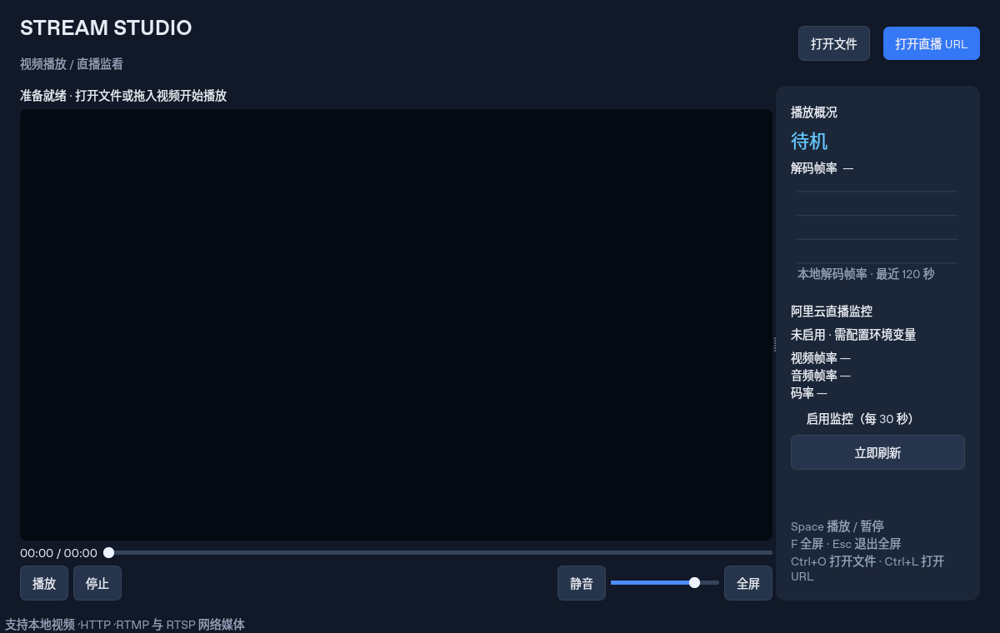

# Stream Studio · pyqt-vlc

基于 PyQt5 与 libVLC 的桌面视频播放器。支持本地媒体、HTTP/HLS、RTMP、RTSP，提供可选的阿里云直播监控。



## 安装与运行

需要 Python 3.9+ 和与 Python 位数相同的 VLC 3.x。

```bash
python -m venv .venv
# Linux / macOS
source .venv/bin/activate
# Windows PowerShell：.venv\Scripts\Activate.ps1
pip install -r requirements.txt
python pyqt/Main.py
```

Linux（Debian / Ubuntu）安装原生库：`sudo apt install vlc`。Linux 视频嵌入使用 X11，Wayland 下需要 XWayland，可用 `QT_QPA_PLATFORM=xcb python pyqt/Main.py` 启动。

Windows 安装官方 VLC；若未自动发现，设置 `PYTHON_VLC_LIB_PATH` 为 libvlc.dll 的完整路径、`PYTHON_VLC_MODULE_PATH` 为 VLC 安装目录。macOS 安装 VLC.app。不要使用旧版固定的 `./vlc-3.0.11` 路径。缺少 VLC 时程序会显示启动错误。

## 操作

- 打开文件或拖入本地视频；打开 URL 可播放网络媒体。
- Space 播放/暂停，F 全屏，Esc 退出全屏，Ctrl+O 打开文件，Ctrl+L 打开 URL。
- 可寻址媒体支持进度拖动；直播显示 LIVE，无法寻址时禁用进度条。
- 音量和窗口位置自动保存；静音独立于音量。播放地址中的签名参数不会显示或保存。
- 右侧趋势图显示 VLC 报告的解码帧率，每秒采样，最多保存 120 个点；它不是云端帧率。

## 可选阿里云监控

基础播放不需要阿里云 SDK 或账号。需要监控时安装：

```bash
pip install -r requirements-aliyun.txt
export ALIBABA_CLOUD_ACCESS_KEY_ID='你的 AccessKey ID'
export ALIBABA_CLOUD_ACCESS_KEY_SECRET='你的 AccessKey Secret'
export ALIYUN_LIVE_DOMAIN='你的推流域名'
export ALIYUN_REGION='cn-shenzhen'
# 可选：多流时筛选目标
export ALIYUN_LIVE_APP='app'
export ALIYUN_LIVE_STREAM='stream'
python pyqt/Main.py
```

以上是 bash 语法；PowerShell 使用 `$env:变量名='值'`。使用具备查询权限的 RAM 凭据。不要将密码、AccessKey 或签名直播地址写入源码、提交到仓库。

勾选启用监控，每 30 秒查询一次；也可立即刷新。查询运行在单个后台线程，失败不阻塞播放，不启动重复请求。查询时间采用 UTC，取约两分钟前的数据。云端无数据时明确显示暂无数据，不伪造为 0。未设置流筛选时展示接口返回的第一条流。关闭窗口时会等待当前有限超时的查询结束后释放线程与 VLC。

阿里云 API 网络访问和播放地址访问是两条独立路径。VPS 转发并非本地播放的前提，本次没有改动远程服务器。要验证转发，仍需要有效的源流、目标播放地址和云端配置；仅凭 SSH 登录信息无法验证真实直播链路。

## 验证

```bash
pip install pytest
QT_QPA_PLATFORM=offscreen python -m pytest -q
```

回归测试覆盖 URL 校验、时间显示、取消文件选择、直播切换本地、缓冲状态、进度控制、监控配置和对话框。播放器测试使用替身隔离原生 VLC；真实播放需另行验证。

旧 Qt Designer 文件保留供参考；运行界面由 `Call_MainWindow.py` 构建，原有 qdarkstyle、pandas、Matplotlib、pyqtgraph 不再是运行依赖。

本次验证：21 项自动回归通过；Linux 虚拟 X11 + libVLC 3.0.23 验证播放状态、时间推进（25 fps）、暂停、跳转、恢复、停止和释放资源。虚拟显示存在 Mesa 共享内存警告，未确认实际画面与声音输出；Windows / macOS、真实阿里云 API 与公网直播尚未验证。
